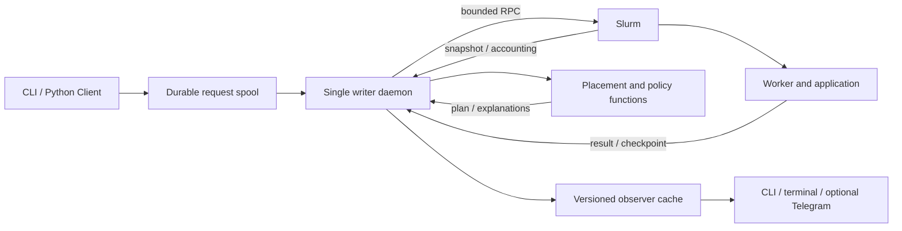

# Architecture

The design separates planning from effects. A client atomically publishes JSON
requests. One flock-protected daemon owns scheduler state. The daemon observes
Slurm, reconciles attempts, calculates a plan and executes a bounded action.
Workers run inside allocations and publish application outcomes.

## Functional core and explicit effects

`memory`, `shape`, limit checks, scoring and record projections transform inputs
into results. Planning uses private snapshot copies to simulate reservations;
`reserve` mutates such a copy. This is not a strictly functional codebase: clocks,
path normalization and optional plugin I/O still exist. Never describe a
forecast as globally deterministic unless all such inputs are fixed.

`planning.queue_actions` shares decision logic between the daemon and forecast.
`Daemon` accepts a backend, allowing tests to use `Fake` instead of Slurm.
`slurm.py`, the daemon and workers perform external effects. Plugin planning
hooks must not submit jobs or change shared state.

## Persistence and recovery

The state directory contains inbox, original submissions, receipts, state.json,
status.json, monitor.json, events.jsonl and per-task/per-attempt directories.
JSON publication uses temporary files, fsync and atomic replacement. Terminal
history may be compacted into content-addressed archives. No SQLite WAL is used.

Persist intent before sbatch/scancel. An ambiguous sbatch result enters
SUBMIT_UNKNOWN; unique JobName reconciliation is required. A missing accounting
record alone is not evidence that submission failed. Existing workers survive a
daemon restart. Cancellation intent survives failures and is retried at a bounded
rate; a successful scancel RPC alone does not free locally accounted resources.

## Scheduling boundaries

The scheduler uses bounded beam search (configurable window/width), not a global
optimum proof. Placement obeys node health, typed resources, profile restrictions,
local limits and visible enforced Slurm limits. Optional group CPU fairness is
snapshot-based, not a historical CPU-hour entitlement system.

Shared handlers are trusted same-account processes with separate step resource
limits. They share the allocation's lifetime. They are not an isolation mechanism
for mutually untrusted users and do not migrate live during service renewal.

## Extension and observation boundaries

Plugins are installed, administrator-selected code with API version 1. Resource
rewrites are validated before admission; infrastructure failures cannot be
reclassified as expected application outcomes. Display hooks run only inside the
protected observer publication step. The authoritative scheduler remains alive
if an observer or display hook fails. Observers never inspect scientific sidecars.

See [plugins.md](plugins.md) for exact hooks and failure semantics.
